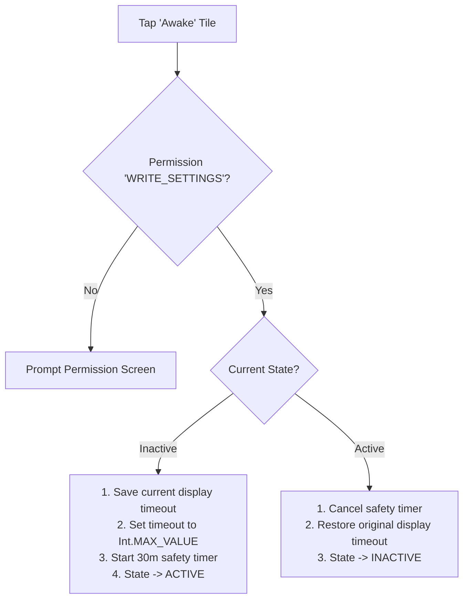

<div align="center">

# ☕ Awake

**A minimalist, robust, zero-bloat Quick Settings Tile for Android to keep your screen awake.**

[](https://kotlinlang.org)
[-green.svg?style=flat&logo=android)](https://developer.android.com)
[](LICENSE)
[](CONTRIBUTING.md)

</div>

---

## 📖 Overview

**Awake** is an ultra-lightweight Android utility designed for one thing only: preventing your screen from going into sleep mode directly from your Quick Settings shade.

Unlike traditional wake-lock apps that fail on aggressive OEM battery managers (like Xiaomi MIUI/HyperOS, Samsung One UI, Huawei EMUI, etc.), **Awake** alters the system screen-off timeout dynamically. When toggled off, your original timeout is restored down to the millisecond.

---

## ✨ Features

- ⚡ **Instant Toggle**: Single-tap switch directly inside your Quick Settings panel.
- 🛡️ **OEM-Proof (Works on MIUI / HyperOS)**: Bypasses background killer algorithms by temporarily setting the system screen timeout to infinite and reverting to your exact preference upon deactivation.
- ⏳ **Safety Auto-off (30 min)**: Automatic 30-minute safety fallback to protect your battery if you forget the tile turned on.
- 🪶 **Zero Battery Drain & Zero Bloat**: No persistent background workers, no tracking, no ads, no heavy runtime dependencies.
- 🎨 **Adaptive Vector Icon**: Beautiful coffee cup icon matching Android Material You dynamic colors.

---

## 🚀 How It Works



---

## 📲 Installation & Setup

### 1. Install the APK
Download the latest APK release or compile it using:
```bash
./gradlew assembleDebug
```
And install via ADB:
```bash
adb install -r app/build/outputs/apk/debug/app-debug.apk
```

### 2. Add the Tile to Quick Settings
1. Swipe down the notifications shade twice.
2. Tap the **Edit (Pencil)** icon.
3. Locate **Awake** (coffee cup icon ☕) and drag it to your active tiles.

### 3. Grant One-Time Permission
- On the very first tap, Awake will prompt you to enable **"Allow modifying system settings"**.
- Toggle it **ON** and return. From that moment, your screen toggle works seamlessly!

---

## 🛠️ Tech Stack & Architecture

- **Language**: Kotlin
- **Component**: `TileService` (`android.service.quicksettings.TileService`)
- **API Target**: `minSdk 24` (Android 7.0) to `compileSdk 36` (Android 15+)
- **Build System**: Gradle 9 with Android Gradle Plugin (AGP) 9 & Version Catalogs

---

## 📄 License

This project is licensed under the [MIT License](LICENSE) - feel free to use, modify, and distribute as you wish.
